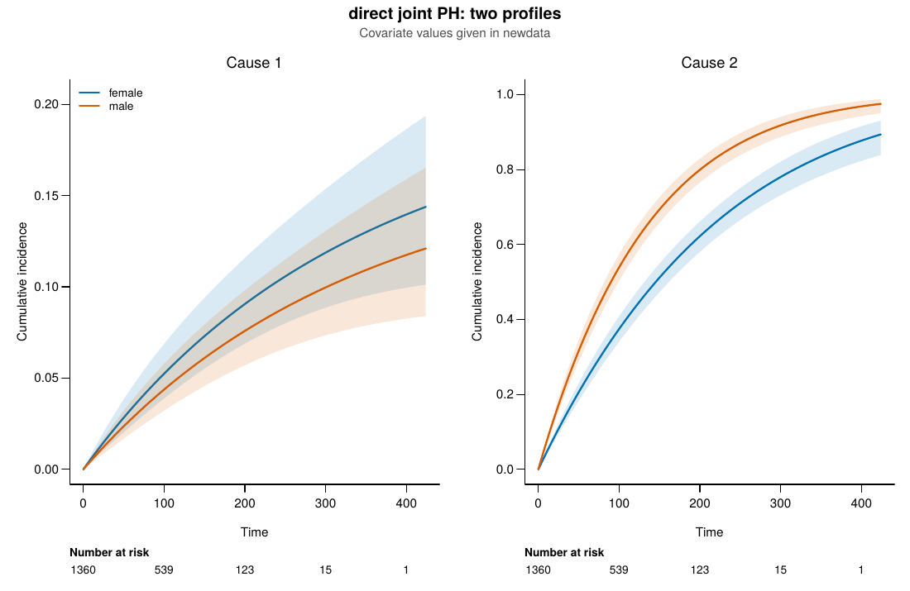
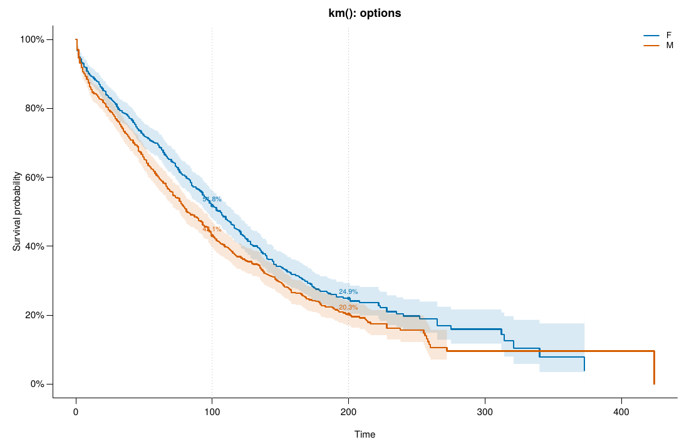

# SurvX

<!-- badges: start -->
[](https://github.com/stats9/SurvX/actions/workflows/R-CMD-check.yaml)
[-blue.svg)](https://www.gnu.org/licenses/gpl-3.0)
[](https://lifecycle.r-lib.org/articles/stages.html#experimental)
<!-- badges: end -->

**Survival and competing risks analysis with direct parametric models for the cumulative
incidence function.**

SurvX brings the standard tools of survival and competing risks analysis together with the
*direct* parametric regression models for the cumulative incidence function (CIF) of Jeong and
Fine (2006, 2007), in one package with one formula interface and one style of output:

- **Nonparametric estimation and tests:** Kaplan-Meier, Aalen-Johansen, log-rank and Gray tests, restricted mean survival time.
- **Semiparametric regression:** Cox, cause-specific Cox and Fine-Gray models, with predicted absolute risks.
- **Direct parametric CIF regression:** eight baseline families and three links (proportional subdistribution hazards, proportional odds, generalized odds rate). Three estimators are available: joint likelihood, inverse-probability-of-censoring weighted likelihood, and the constrained two-cause model of Shi, Cheng and Jeong (2013).
- **Prediction performance:** IPCW Brier score, index of prediction accuracy (IPA), time-dependent AUC and calibration. Models are compared side by side with cross-validation.
- **Cumulative incidence plots:** every model and every cause can be plotted, at chosen covariate values, at typical values, averaged over the sample, or without covariates. Confidence bands come from the delta method or the bootstrap. Plots use base graphics or ggplot2.

All computation runs in a C++17 core written for this package with no external libraries. The R
layer uses [S7](https://rconsortium.github.io/S7/) classes and supports the usual S3 generics
(`print`, `summary`, `coef`, `vcov`, `confint`, `predict`, `plot`, `AIC`, `update`, ...).

> **Development version.** The interface may change before version 1.0. Every release is checked
> against survival, cmprsk and riskRegression by the validation script described
> [below](#validation). Please report problems at <https://github.com/stats9/SurvX/issues>.

---

## Contents

- [Installation](#installation)
- [Quick start](#quick-start)
- [Functions](#functions)
- [The direct models](#the-direct-models)
- [Interpreting the output](#interpreting-the-output)
- [Cumulative incidence plots](#cumulative-incidence-plots)
- [Comparing prediction models](#comparing-prediction-models)
- [Objects and methods](#objects-and-methods)
- [Validation](#validation)
- [Simulation study and data analysis scripts](#simulation-study-and-data-analysis-scripts)
- [Methods and references by function](#methods-and-references-by-function)
- [Methods original to SurvX](#methods-original-to-survx)
- [Related software](#related-software)
- [Citation](#citation)
- [License](#license)

---

## Installation

```r
# install.packages("remotes")
remotes::install_github("stats9/SurvX")
```

You need a C++17 compiler: Rtools on Windows, or the Xcode command line tools on macOS
(`xcode-select --install`). Linux usually has one already.

| Packages | Role |
| --- | --- |
| S7 | the only required R package |
| survival, cmprsk, riskRegression, prodlim | optional; used by the validation script |
| ggplot2 | optional; used by `engine = "ggplot2"` and `autoplot()` |

From a source archive: `R CMD INSTALL SurvX_<version>.tar.gz`.

## Quick start

The examples use the `mgus2` data of the survival package. 1,384 patients with monoclonal
gammopathy (1,360 with complete covariates) are followed for progression to a plasma cell malignancy (cause 1) or death without
progression (cause 2).

```r
library(SurvX)
m <- survival::mgus2
m$time   <- ifelse(m$pstat == 0, m$futime, m$ptime)            # months
m$status <- ifelse(m$pstat == 0, 2L * m$death, 1L)            # 0 censored, 1 progression, 2 death
d <- na.omit(data.frame(time = m$time, status = m$status, sex = m$sex,
                        age = m$age - 70, hgb = m$hgb - 13, mspike = m$mspike))
d <- d[d$time > 0, ]

aj(Event(time, status) ~ sex, d)                                # Aalen-Johansen and Gray's test
fit <- directcif(Event(time, status) ~ sex + age + hgb + mspike, d,
                 baseline = "gompertz", link = "PH")             # direct model, all causes
fit                                                             # report for clinical readers
predict(fit, newdata = data.frame(sex = "F", age = 0, hgb = 0, mspike = 1),
        times = c(60, 120, Inf), cause = 1, se = TRUE)          # Inf = long-run risk (plateau)
cif_plot(fit, newdata = data.frame(sex = c("F", "M"), age = 0, hgb = 0, mspike = 1),
         labels = c("female", "male"))
compare_models(Event(time, status) ~ sex + age + hgb + mspike, d, times = c(50, 100))
```

`Event(time, status)` is the response. `status` is 0 for a censored observation and 1, ..., K for
the cause of failure; with K = 1 this is ordinary survival data.

**Covariates** work as in `lm()` and `survival::coxph()`:

- Factor and character columns become indicator columns, with the first level as reference.
- Interactions (`a * b`) and transformations (`log(x)`, `I(x^2)`) work.
- A categorical variable stored as numbers must be wrapped as `factor(x)`.
- `predict()` takes a data frame with the original columns. Factor levels can be given by name.

For the direct models, centre continuous covariates. The baseline is then the CIF of a typical
patient, which keeps the plateau parameters interpretable and stabilises the fit.

## Functions

| Function | Purpose |
| --- | --- |
| `Event(time, status)` | response for all model formulas |
| `km(formula, data, level)` | Kaplan-Meier survival curves: Greenwood standard errors, log-scale intervals, median survival with its confidence limits, log-rank test between groups |
| `rmst(time, status, tau)` | restricted mean survival time up to `tau` with its standard error |
| `logrank_test(time, status, group, strata, rho)` | K-sample log-rank test with the G-rho weight family; stratified |
| `aj(formula, data, level)` | Aalen-Johansen cumulative incidence of every cause: standard errors, cloglog intervals, Gray's test between groups |
| `gray_test(time, status, group, cause, strata, rho)` | Gray's K-sample test for equal cumulative incidence; stratified |
| `cox(formula, data, ties, weights)` | Cox proportional hazards model: Efron or Breslow ties, case weights, baseline hazard, predicted survival |
| `csc(formula, data, ties, product_limit)` | cause-specific Cox models for all causes and the cumulative incidence they imply |
| `fg(formula, data, cause, variance)` | Fine-Gray proportional subdistribution hazards model: robust or model-based variance, predicted CIF |
| `directcif(formula, data, baseline, link, estimation, ...)` | direct parametric CIF regression; see [The direct models](#the-direct-models) |
| `predict(fit, newdata, times, cause, se)` | absolute risks (CIF or survival) for new patients; delta-method standard errors for direct models |
| `cif_data()`, `cif_plot()` | data behind, and drawing of, cumulative incidence curves for any model(s) |
| `brier_score()`, `auc_t()`, `calibration()` | IPCW Brier score, time-dependent AUC, calibration in risk groups, at a time horizon |
| `compare_models(formula, data, times, direct, cause, folds)` | cross-validated comparison of direct, Fine-Gray and cause-specific Cox models; runs in the C++ core |
| `cv_compare(formula, data, models, times, ...)` | the same for any list of fitting functions with a `predict` method |
| `estimates(fit)` | every coefficient as a data frame: estimate, standard error, interval, z, p and exponentiated effect |

Every function has a help page (`?directcif`, `?cif_plot`, `?"SurvX-methods"`, ...) with its
references.

## The direct models

For cause *k* and covariates *z*, the direct model specifies the cumulative incidence function itself:

$$F_k(t; z) = 1 - \{1 + \alpha_k\, e^{z^\top \beta_k}\, u_k(t)\}^{-1/\alpha_k}$$

*u<sub>k</sub>* is an increasing baseline function and α<sub>k</sub> is the link parameter of the
generalized odds rate family (Dabrowska and Doksum 1988; Jeong and Fine 2007).

| `link` | α | Effect of a covariate (`exp(beta)`) |
| --- | --- | --- |
| `"PH"` | α → 0 | subdistribution hazard ratio, as in the Fine-Gray model |
| `"PO"` | α = 1 | odds ratio of the cumulative incidence, F/(1 − F) |
| `"GOR"` | estimated | effect on the generalized odds rate scale |
| a number | fixed at that value | as for `"GOR"` |

### Baselines

| `baseline` | Baseline | Parameters (estimation scale) | Source |
| --- | --- | --- | --- |
| `"gompertz"` | *u*(t) = τ(e<sup>ρt</sup> − 1)/ρ; improper (plateau) when ρ < 0 | `rho`, `log_tau` | Jeong & Fine (2006, 2007) |
| `"gompertz3"` | three-parameter Gompertz | `rho`, `log_tau`, `zeta` | Haile et al. (2016) |
| `"weibull"` | *u*(t) = (λt)<sup>κ</sup>; no plateau | `log_lambda`, `log_kappa` | Weibull cumulative hazard (standard) |
| `"mix_weibull"` | baseline CIF p·G(t), G Weibull | `logit_p`, `log_lambda`, `log_kappa` | Larson & Dinse (1985) mixture form; see [original methods](#methods-original-to-survx) |
| `"mix_loglogistic"` | baseline CIF p·G(t), G log-logistic | `logit_p`, `log_lambda`, `log_kappa` | as above |
| `"mix_lognormal"` | baseline CIF p·G(t), G log-normal | `logit_p`, `mu`, `log_sigma` | as above |
| `"logistic3"` | modified three-parameter logistic baseline CIF | `log_b`, `c`, `logit_p` | Cheng (2009) |
| `"spline"` | log *u*(t) a restricted cubic spline in log t with `df` degrees of freedom | `gamma0`, `gamma1`, ... | Royston & Parmar (2002); Lambert et al. (2017); Mozumder et al. (2018) |

`baseline` and `link` take one value for all causes or one value per cause, for example
`baseline = c("gompertz", "weibull")`.

### Estimators

| `estimation` | What is fitted | When to use it |
| --- | --- | --- |
| `"joint"` (default) | all causes together by the full likelihood | some subjects never fail, so the CIFs level off below a total of one |
| `"weighted"` | the cause of interest (`cause =`) alone. Competing events enter through Kaplan-Meier censoring weights, as in Fine & Gray (1999). Sandwich standard errors | no model for the other causes is needed; robust when the joint model is misspecified |
| `"constrained"` | two causes with long-run risks adding up to one: F<sub>2</sub>(t; z) = {1 − F<sub>1</sub>(∞; z)} G(t). G is chosen by `cond`: `"logistic"`, `"weibull"`, `"loglogistic"` or `"lognormal"` | every subject eventually fails from one of the two causes |

References for the estimators:
- joint: Jeong & Fine (2006, 2007)
- weighted: Fine & Gray (1999), Geskus (2011), Lambert et al. (2017)
- constrained: Shi, Cheng & Jeong (2013)

```r
fj <- directcif(Event(time, status) ~ sex + age + hgb + mspike, d)                       # joint, PH
fp <- update(fj, link = "PO")                                                              # joint, PO
fw <- directcif(Event(time, status) ~ sex + age + hgb + mspike, d, estimation = "weighted", cause = 1)
fk <- directcif(Event(time, status) ~ sex + age + hgb + mspike, d, estimation = "constrained",
                cause = 1, cond = "weibull")
AIC(fj, fp)                       # joint and constrained fits have a full likelihood
```

**Sum of the CIFs.** The published joint model does not force the fitted CIFs of all causes to add
up to at most one.

- **Default.** SurvX fits the model as published and reports how many subjects have a fitted sum above one, both within follow-up and in the long run.
- **When the sum exceeds one.** The printed report then suggests the weighted or constrained estimator.
- **Optional constraint.** `constraint = TRUE` keeps the sum below one within follow-up.

**Convergence.** A fit counts as converged only at a stationary point where the information matrix
is positive definite. Families with a plateau are not identified when the data show no plateau.
Such fits are flagged in the output, and their standard errors are not reported.

## Interpreting the output

Printed reports are written for clinical readers:

- effects on their natural scale, with confidence intervals and p-values
- factor levels named against their reference level
- for direct models, the long-run risk at typical covariate values (mean of numeric, most frequent level of categorical covariates)
- a plain-language note on how to read each kind of effect

This is real output on the `mgus2` data:

```text
Direct parametric regression for the cumulative incidence function
  Estimation: joint likelihood of all causes (Jeong & Fine 2006, 2007)
  Subjects: 1360   censored: 397   cause 1: 114   cause 2: 849

Cause 1: baseline Gompertz, link proportional subdistribution hazards (PH)
  Effect of covariates: subdistribution hazard ratio (sHR)
                 sHR          95% CI      z       p
  sex: M vs F   0.83    0.61 to 1.14  -1.15   0.249
  age          1.011  0.992 to 1.030   1.09   0.274
  hgb          0.951  0.862 to 1.050  -0.99   0.321
  mspike        2.58    1.92 to 3.47   6.31  <0.001
  Long-run risk (plateau) at typical covariate values: 0.197 (95% CI 0.081 to 0.349)
...
NOTE: for 969 of 1360 subjects the fitted risks of all causes add up to more than 1 within follow-up
  (largest sum 1.746). The joint model assumes that some subjects never fail; consider
  estimation = "weighted" or "constrained".
```

`summary(fit)` adds:
- predicted risks with intervals at the quartiles of the event times
- baseline parameters on their natural scale
- a section on how to read the effects

| Model | `exp(coef)` | Reads as |
| --- | --- | --- |
| `cox()` | hazard ratio | effect on the rate of the event |
| `csc()` | cause-specific hazard ratio | effect on the rate of one cause among subjects still event-free. It does **not** translate directly into the cumulative incidence, which also depends on the other causes |
| `fg()`, direct `"PH"` | subdistribution hazard ratio | > 1 means a higher cumulative incidence of that cause at every time. Its size is not a ratio of risks |
| direct `"PO"` | odds ratio of the cumulative incidence | ratio of F/(1 − F) between two patients, constant over time |

For absolute risks, use `predict()` or `cif_plot()`.

## Cumulative incidence plots

`cif_plot()` draws the cumulative incidence of every cause for any model, or for a named list of
models to compare. `plot()` on a fitted model calls it, and `ggplot2::autoplot()` returns a ggplot
object.

```r
cif_plot(fj)                                                        # typical covariate values, all causes
cif_plot(fj, newdata = data.frame(sex = c("F", "M"), age = 0, hgb = 0, mspike = 1),
         labels = c("female", "male"))                              # chosen patients
cif_plot(fj, type = "marginal", reference = TRUE)                   # sample average vs Aalen-Johansen
cif_plot(fj, type = "unadjusted")                                   # the same model without covariates
cif_plot(list("direct PH" = fj, "Fine-Gray" = fg(Event(time, status) ~ sex + age + hgb + mspike, d),
              "cause-specific Cox" = csc(Event(time, status) ~ sex + age + hgb + mspike, d)),
         cause.names = c("progression", "death"), percent = TRUE)   # models side by side
cif_plot(fj, layout = "stacked")                                    # causes stacked, event-free on top
cif_data(fj)                                                        # the numbers behind the plot
```

<p align="center"></p>

**Covariate values (`type`, `newdata`)**

| Option | Curves drawn |
| --- | --- |
| `type = "profile"` (default) | one patient with typical covariate values: mean of numeric, most frequent level of categorical covariates. The values are printed under the title |
| `newdata = data.frame(...)` | one curve per row of `newdata` |
| `type = "marginal"` | the average of the predicted curves over all subjects |
| `type = "unadjusted"` | the model refitted without covariates. This is still a parametric curve for direct models (Jeong & Fine 2006). For cause-specific Cox it equals the Aalen-Johansen estimate |

**Confidence bands**
- **Direct models:** delta method.
- **Aalen-Johansen:** Greenwood-type variance.
- **Fine-Gray and cause-specific Cox:** nonparametric bootstrap of subjects in the C++ core. Set the number of resamples with `B` and the random seed with `seed`.
- **Scale:** all intervals are built on the complementary log-log scale, so they stay inside [0, 1]. Percentile intervals are available with `interval = "percentile"`.

**Layouts:** one panel per cause (`"panels"`), all causes in one panel (`"overlay"`), or stacked
(`"stacked"`). In the stacked layout, a note marks the time from which the risks of all causes add
up to more than one.

**Everything can be switched off**, so a figure shows only what you want:

| Argument | Element | Default |
| --- | --- | --- |
| `conf.int` | confidence bands | `TRUE` |
| `risk.table` | numbers at risk under the axis | `TRUE` |
| `legend` | legend | `TRUE` |
| `caption` | line giving the covariate values | `TRUE` |
| `reference` | Aalen-Johansen curve of the whole sample | `FALSE` |
| `mark.times` | risk values written at chosen times | none |
| `percent` | probability axis in percent | `FALSE` |
| `grid` | horizontal grid lines | `FALSE` |
| `cex` | size of all text (ggplot2: base size 12 × `cex`) | `0.85` |

Further arguments:
- `cause`, `cause.names` and `labels`
- `col`, `lty` and `lwd`; the default colours are the colour-blind-safe Okabe-Ito palette
- `xlab`, `ylab`, `main`, `xlim` and `ylim`
- `engine = "ggplot2"`

Long titles and captions are wrapped to the width of the device.

`plot()` of a `km()` fit takes the same switches, and adds censoring marks and the median
(`median = TRUE`):

<p align="center"></p>

## Comparing prediction models

```r
cm <- compare_models(Event(time, status) ~ sex + age + hgb + mspike, d, times = c(50, 100),
                     folds = 5, cause = 1)
cm                      # models ranked by Brier score at each horizon, with explanations
plot(cm, measure = "brier")
as.data.frame(cm)
```

By default `compare_models()` fits:
- five direct models: joint PH and PO, weighted PH and PO, and constrained PH
- the Fine-Gray model
- cause-specific Cox

Other direct models are given in `direct =`, as `c(baseline, link[, estimation[, cond]])`.

**Reported measures**, cross-validated with `folds` folds:
- **Brier score:** IPCW (Graf et al. 1999; Gerds & Schumacher 2006)
- **IPA:** index of prediction accuracy (Kattan & Gerds 2018)
- **Time-dependent AUC:** Blanche, Dartigues & Jacqmin-Gadda (2013)
- **Calibration error:** described under [original methods](#methods-original-to-survx)

AIC is also reported for fits with a full likelihood. For any other model with a `predict` method,
use `cv_compare()`.

<p align="center"></p>

## Objects and methods

Fitted models are S7 objects: `CoxFit`, `FineGrayFit`, `CSCFit`, `DirectCIFFit`, `KMFit`, `AJFit`
and `ModelComparison`. Properties are read with `@`, for example `fit@coefficients`,
`fit@converged` or `fit@diagnostics`, and listed with `S7::props(fit)`. The usual S3 generics work
as they do for `lm()` or `survival::coxph()`:

```r
print(fit); summary(fit); coef(fit); vcov(fit); confint(fit); estimates(fit)
logLik(fit); AIC(fit1, fit2); BIC(fit); nobs(fit)
predict(fit, newdata, times, cause = 1, se = TRUE)
plot(fit); ggplot2::autoplot(fit)
formula(fit); terms(fit); model.matrix(fit); getCall(fit); update(fit, link = "PO")
as.data.frame(summary(km_fit, times = c(12, 24)))
```

See `?"SurvX-methods"` for the full list.

## Validation

`inst/validation/check_SurvX.R` compares SurvX with established packages and with independent R
code of the published formulas. It writes:
- a pass/fail report (`check_SurvX_report.csv`)
- example output (`SurvX_output_examples.txt`)
- all plots (`SurvX_plots.pdf`)

| Compared quantity | Reference | Largest relative difference |
| --- | --- | --- |
| Kaplan-Meier survival, Greenwood SE, limits, median, log-rank | `survival::survfit`, `survdiff` | < 1e-14 |
| Aalen-Johansen CIF, Gray's test | `cmprsk::cuminc` | < 1e-14 |
| Cox coefficients, SE, log-likelihood, predicted survival | `survival::coxph`, `survfit.coxph` | < 1e-14 |
| Fine-Gray coefficients, robust SE, predicted CIF | `cmprsk::crr`, `predict.crr` | 3e-8, 7e-6, 5e-9 |
| Cause-specific Cox CIF | `riskRegression::predictRisk` | < 1e-15 |
| Brier score, time-dependent AUC | `riskRegression::Score` | < 1e-14 |
| Direct models: log-likelihood, predicted CIF and plateau | R code of the formulas in Jeong & Fine (2006, 2007) | < 1e-15 |
| Constrained model: log-likelihood | R code of eqs. (5) and (7) of Shi, Cheng & Jeong (2013) | < 1e-14 |

All 85 checks pass with SurvX 0.4.3, R on the maintainer's machine, `mgus2` data.

The C++ core has a further test suite of about 400 checks. These cover:
- gradients and information matrices against numerical derivatives
- fits that an independent optimiser cannot improve
- Monte Carlo coverage of the confidence intervals
- AddressSanitizer and UndefinedBehaviorSanitizer runs

## Simulation study and data analysis scripts

| Script | Content |
| --- | --- |
| `inst/simulations/direct_vs_finegray.R` | six data-generating scenarios × three sample sizes × 13 models (direct joint, weighted and constrained; Fine-Gray; cause-specific Cox). Reports bias, RMSE and coverage of predicted risks and Brier scores. Usage: `Rscript direct_vs_finegray.R <replications> <sizes>` |
| `inst/analysis/analyse_data.R` | fits and cross-validates every model on one data set, writes reports, tables and plots. Demonstration: `mgus2`. Edit its SETTINGS block for your own data |

Find the installed scripts with `system.file("simulations", package = "SurvX")`.

## Methods and references by function

| Function / feature | Method | References |
| --- | --- | --- |
| `km()` | product-limit estimator; Greenwood variance; log-scale intervals; median and its limits where the confidence limits of the curve cross 0.5, as in `survival::survfit` | Kaplan & Meier (1958); Greenwood (1926); Brookmeyer & Crowley (1982) |
| `rmst()` | area under the Kaplan-Meier curve up to τ | Irwin (1949); Royston & Parmar (2013) |
| `logrank_test()` | log-rank and G-rho family, stratified | Mantel (1966); Peto & Peto (1972); Harrington & Fleming (1982) |
| `aj()` | Aalen-Johansen estimator of the CIF; cloglog intervals | Aalen & Johansen (1978); Kalbfleisch & Prentice (2002) |
| `gray_test()` | K-sample test for CIFs; variance ported from the Fortran routine `crstm` of cmprsk | Gray (1988) |
| `cox()` | partial likelihood; Efron and Breslow ties; Breslow baseline hazard | Cox (1972); Breslow (1974); Efron (1977) |
| `csc()` | cause-specific Cox models combined into CIFs | Prentice et al. (1978); Benichou & Gail (1990) |
| `fg()` | proportional subdistribution hazards with IPCW risk sets; robust variance | Fine & Gray (1999) |
| `directcif(estimation = "joint")` | direct parametric CIF models, joint likelihood | Jeong & Fine (2006, 2007) |
| links PH / PO / GOR | generalized odds rate transformation | Dabrowska & Doksum (1988); Jeong & Fine (2007) |
| `"gompertz3"`, `"logistic3"`, `"spline"` baselines | see [Baselines](#baselines) | Haile et al. (2016); Cheng (2009); Royston & Parmar (2002) |
| `directcif(estimation = "weighted")` | weighted likelihood with Kaplan-Meier censoring weights; sandwich variance | Fine & Gray (1999); Geskus (2011); Lambert, Wilkes & Crowther (2017) |
| `directcif(estimation = "constrained")` | two causes with asymptotes adding to one | Shi, Cheng & Jeong (2013); Cheng (2009) |
| `predict()` of direct models | delta method | e.g. Casella & Berger (2002), Sec. 5.5 |
| `brier_score()` | IPCW Brier score for competing risks | Graf et al. (1999); Gerds & Schumacher (2006) |
| IPA | 1 − Brier(model)/Brier(null model) | Kattan & Gerds (2018) |
| `auc_t()` | IPCW time-dependent AUC with competing risks (cases: cause of interest by t; controls: all others) | Blanche, Dartigues & Jacqmin-Gadda (2013) |
| `compare_models()`, `cv_compare()` | K-fold cross-validation of the measures above | Hastie, Tibshirani & Friedman (2009), Sec. 7.10 |
| `cif_plot()` bands for Fine-Gray / CSC | nonparametric bootstrap of subjects | Efron & Tibshirani (1993) |
| Optimiser | Levenberg-Marquardt with Marquardt scaling | Levenberg (1944); Marquardt (1963) |
| Plot colours | Okabe-Ito palette | Okabe & Ito (2008) |

### References

- Aalen, O. O. and Johansen, S. (1978). An empirical transition matrix for non-homogeneous Markov chains based on censored observations. *Scandinavian Journal of Statistics*, 5, 141–150.
- Benichou, J. and Gail, M. H. (1990). Estimates of absolute cause-specific risk in cohort studies. *Biometrics*, 46, 813–826.
- Blanche, P., Dartigues, J.-F. and Jacqmin-Gadda, H. (2013). Estimating and comparing time-dependent areas under receiver operating characteristic curves for censored event times with competing risks. *Statistics in Medicine*, 32(30), 5381–5397. doi:10.1002/sim.5958
- Breslow, N. E. (1974). Covariance analysis of censored survival data. *Biometrics*, 30, 89–99.
- Brookmeyer, R. and Crowley, J. (1982). A confidence interval for the median survival time. *Biometrics*, 38, 29–41.
- Casella, G. and Berger, R. L. (2002). *Statistical Inference*, 2nd ed. Duxbury.
- Cheng, Y. (2009). Modeling cumulative incidences of dementia and dementia-free death using a novel three-parameter logistic function. *The International Journal of Biostatistics*, 5(1), Article 19. doi:10.2202/1557-4679.1183
- Cox, D. R. (1972). Regression models and life-tables. *Journal of the Royal Statistical Society, Series B*, 34, 187–220.
- Dabrowska, D. M. and Doksum, K. A. (1988). Estimation and testing in a two-sample generalized odds-rate model. *Journal of the American Statistical Association*, 83, 744–749. doi:10.1080/01621459.1988.10478657
- Efron, B. (1977). The efficiency of Cox's likelihood function for censored data. *Journal of the American Statistical Association*, 72, 557–565.
- Efron, B. and Tibshirani, R. J. (1993). *An Introduction to the Bootstrap*. Chapman & Hall.
- Fine, J. P. and Gray, R. J. (1999). A proportional hazards model for the subdistribution of a competing risk. *Journal of the American Statistical Association*, 94, 496–509.
- Gerds, T. A. and Schumacher, M. (2006). Consistent estimation of the expected Brier score in general survival models with right-censored event times. *Biometrical Journal*, 48(6), 1029–1040. doi:10.1002/bimj.200610301
- Geskus, R. B. (2011). Cause-specific cumulative incidence estimation and the Fine and Gray model under both left truncation and right censoring. *Biometrics*, 67, 39–49.
- Graf, E., Schmoor, C., Sauerbrei, W. and Schumacher, M. (1999). Assessment and comparison of prognostic classification schemes for survival data. *Statistics in Medicine*, 18, 2529–2545.
- Gray, R. J. (1988). A class of K-sample tests for comparing the cumulative incidence of a competing risk. *The Annals of Statistics*, 16, 1141–1154.
- Greenwood, M. (1926). The natural duration of cancer. *Reports on Public Health and Medical Subjects*, 33. HMSO.
- Haile, S. R., Jeong, J.-H., Chen, X. and Cheng, Y. (2016). A 3-parameter Gompertz distribution for survival data with competing risks, with an application to breast cancer data. *Journal of Applied Statistics*, 43(12), 2239–2253.
- Harrington, D. P. and Fleming, T. R. (1982). A class of rank test procedures for censored survival data. *Biometrika*, 69, 553–566.
- Hastie, T., Tibshirani, R. and Friedman, J. (2009). *The Elements of Statistical Learning*, 2nd ed. Springer.
- Irwin, J. O. (1949). The standard error of an estimate of expectation of life. *Journal of Hygiene*, 47, 188–189.
- Jeong, J.-H. and Fine, J. (2006). Direct parametric inference for the cumulative incidence function. *Journal of the Royal Statistical Society, Series C*, 55(2), 187–200. doi:10.1111/j.1467-9876.2006.00532.x
- Jeong, J.-H. and Fine, J. P. (2007). Parametric regression on cumulative incidence function. *Biostatistics*, 8(2), 184–196. doi:10.1093/biostatistics/kxj040
- Kalbfleisch, J. D. and Prentice, R. L. (2002). *The Statistical Analysis of Failure Time Data*, 2nd ed. Wiley.
- Kaplan, E. L. and Meier, P. (1958). Nonparametric estimation from incomplete observations. *Journal of the American Statistical Association*, 53, 457–481.
- Kattan, M. W. and Gerds, T. A. (2018). The index of prediction accuracy: an intuitive measure useful for evaluating risk prediction models. *Diagnostic and Prognostic Research*, 2, 7. doi:10.1186/s41512-018-0029-2
- Lambert, P. C., Wilkes, S. R. and Crowther, M. J. (2017). Flexible parametric modelling of the cause-specific cumulative incidence function. *Statistics in Medicine*, 36(9), 1429–1446. doi:10.1002/sim.7208
- Larson, M. G. and Dinse, G. E. (1985). A mixture model for the regression analysis of competing risks data. *Journal of the Royal Statistical Society, Series C*, 34, 201–211.
- Levenberg, K. (1944). A method for the solution of certain non-linear problems in least squares. *Quarterly of Applied Mathematics*, 2, 164–168.
- Mantel, N. (1966). Evaluation of survival data and two new rank order statistics arising in its consideration. *Cancer Chemotherapy Reports*, 50, 163–170.
- Marquardt, D. W. (1963). An algorithm for least-squares estimation of nonlinear parameters. *Journal of the Society for Industrial and Applied Mathematics*, 11, 431–441.
- Mozumder, S. I., Rutherford, M. J. and Lambert, P. C. (2018). Direct likelihood inference on the cause-specific cumulative incidence function: a flexible parametric regression modelling approach. *Statistics in Medicine*, 37(1), 82–97. doi:10.1002/sim.7498
- Okabe, M. and Ito, K. (2008). Color universal design (CUD): how to make figures and presentations that are friendly to colorblind people. <https://jfly.uni-koeln.de/color/>
- Peto, R. and Peto, J. (1972). Asymptotically efficient rank invariant test procedures. *Journal of the Royal Statistical Society, Series A*, 135, 185–207.
- Prentice, R. L., Kalbfleisch, J. D., Peterson, A. V., Flournoy, N., Farewell, V. T. and Breslow, N. E. (1978). The analysis of failure times in the presence of competing risks. *Biometrics*, 34, 541–554.
- Royston, P. and Parmar, M. K. B. (2002). Flexible parametric proportional-hazards and proportional-odds models for censored survival data, with application to prognostic modelling and estimation of treatment effects. *Statistics in Medicine*, 21, 2175–2197.
- Royston, P. and Parmar, M. K. B. (2013). Restricted mean survival time: an alternative to the hazard ratio for the design and analysis of randomized trials with a time-to-event outcome. *BMC Medical Research Methodology*, 13, 152.
- Shi, H., Cheng, Y. and Jeong, J.-H. (2013). Constrained parametric model for simultaneous inference of two cumulative incidence functions. *Biometrical Journal*, 55(1), 82–96.

## Methods original to SurvX

The following elements are not taken from the literature cited above. They were designed for this
package and are documented in the help pages:

- **Mixture baselines.** The baselines `mix_weibull`, `mix_loglogistic` and `mix_lognormal` combine a mixture baseline CIF p·G(t) with the direct-model links. The mixture idea itself goes back to Larson and Dinse (1985).
- **Families for G.** The constrained model offers Weibull, log-logistic and log-normal families for G, in addition to the modified logistic form used by Shi, Cheng and Jeong (2013).
- **Weighted likelihood.** The weighted estimator uses a time-integrated form of the weighted likelihood. The `censoring_grid` option coarsens the censoring distribution to speed up large fits.
- **Optimiser.** The fits use a staged strategy (baseline first, then all parameters), detection of stalled or diverging fits, and a rescaled spline basis.
- **Calibration error.** This is the mean absolute difference between predicted risk and Aalen-Johansen risk within groups of predicted risk.
- **Bootstrap bands.** The bootstrap bands for Fine-Gray and cause-specific Cox curves use the bootstrap standard error on the complementary log-log scale.

These choices still need independent assessment. Please cite the package when you use them.

## Related software

- [survival](https://CRAN.R-project.org/package=survival): Kaplan-Meier, Cox and multi-state models
- [cmprsk](https://CRAN.R-project.org/package=cmprsk): cumulative incidence, Gray's test and the Fine-Gray model
- [riskRegression](https://CRAN.R-project.org/package=riskRegression): absolute risk regression and prediction performance
- [flexsurv](https://CRAN.R-project.org/package=flexsurv): flexible parametric survival and multi-state models
- [timeROC](https://CRAN.R-project.org/package=timeROC): time-dependent ROC curves
- [cmpp](https://CRAN.R-project.org/package=cmpp): direct parametric inference for the CIF (Ezzatabadipour 2025)

## Citation

```r
citation("SurvX")
```

Ezzatabadipour, H. (2026). *SurvX: Survival and Competing Risks Analysis with Direct Parametric
Models for the Cumulative Incidence Function*. R package version 0.5.1.
<https://github.com/stats9/SurvX>

When you use the direct models, please also cite Jeong & Fine (2006, 2007). For the weighted and
constrained estimators, also cite the references given above.

## License

GPL (>= 3). The variance computation of Gray's K-sample test (`src/survcore/tests.hpp`) is a port
of the Fortran routine `crstm` of the cmprsk package, © 2000 Robert Gray, GPL (>= 2); see
`inst/COPYRIGHTS`.
