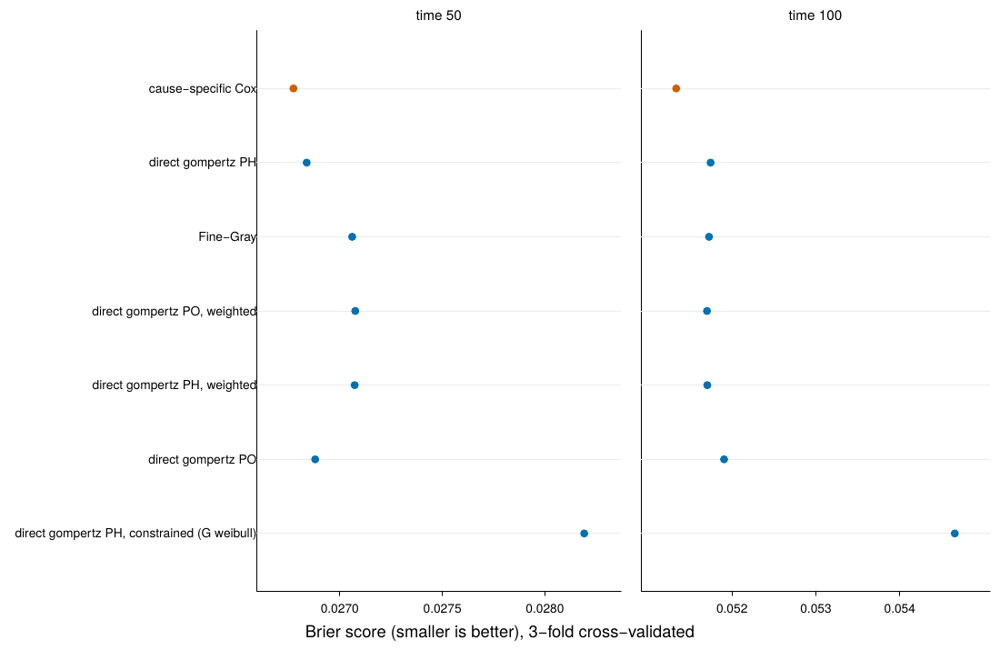

# SurvX

<!-- badges: start -->
[](https://github.com/stats9/SurvX/actions/workflows/check-ubuntu.yaml)
[](https://github.com/stats9/SurvX/actions/workflows/check-ubuntu-devel.yaml)
[](https://github.com/stats9/SurvX/actions/workflows/check-macos.yaml)
[](https://github.com/stats9/SurvX/actions/workflows/check-windows.yaml)
[](https://github.com/stats9/SurvX/actions/workflows/check-cran.yaml)
[](https://doi.org/10.5281/zenodo.24255828)
[-blue.svg)](https://www.gnu.org/licenses/gpl-3.0)
[](https://lifecycle.r-lib.org/articles/stages.html#stable)
<!-- badges: end -->

**Survival, competing risks and cure regression models, with every result traced to the
literature and checked against the reference packages.**

SurvX brings the standard tools of survival and competing risks analysis together with the
*direct* parametric regression models for the cumulative incidence function (CIF) of Jeong and
Fine (2006, 2007), in one package with one formula interface and one style of output:

- **Nonparametric estimation and tests:** Kaplan-Meier, Aalen-Johansen, log-rank and Gray tests, restricted mean survival time, Nelson-Aalen and kernel-smoothed hazard.
- **Cox regression:** Efron and Breslow ties, strata, delayed entry and (start, stop] data, time-varying coefficients (`tt()`), case weights, clustered data with robust variance, residuals and proportional hazards tests.
- **Competing risks regression:** cause-specific hazards (Cox or parametric) and the Fine-Gray model, with delayed entry and robust or bootstrap variance, and predicted absolute risks.
- **Parametric and cure models:** exponential, Weibull, Gompertz, log-normal, log-logistic, generalized gamma, piecewise exponential and Royston-Parmar spline models (PH or AFT), and mixture and non-mixture cure models.
- **Direct parametric CIF regression:** eight baseline families and three links (proportional subdistribution hazards, proportional odds, generalized odds rate). Three estimators are available: joint likelihood, inverse-probability-of-censoring weighted likelihood, and the constrained model of Shi, Cheng and Jeong (2013), extended to any number of causes and to covariates that change when the competing events occur (accelerated failure time).
- **Prediction performance:** IPCW Brier score, index of prediction accuracy (IPA) and time-dependent AUC, each with its standard error; calibration in risk groups, observed/expected ratio and the integrated calibration index (ICI, E50, E90); concordance indices of Harrell, Uno and, with competing risks, Wolbers; decision curves; likelihood-ratio tests of nested models. Models are compared side by side with cross-validation and paired tests.
- **Time-varying effects:** `time_effects()` screens every covariate of a Cox, cause-specific Cox or Fine-Gray model for a change of its effect over time, chooses the form of the change and reports the hazard ratio over follow-up.
- **Adjusted risks and causal contrasts:** `adjusted_risk()` gives the absolute risk under each treatment by standardisation (g-formula) or inverse probability weighting, with risk differences and ratios and balance diagnostics.
- **Interval-censored data:** `Interval()` outcomes with the Turnbull estimate (`turnbull()`), parametric regression (`parsurv()`) and direct CIF models (`directcif()`).
- **Clustered data:** shared gamma frailty in `cox()` and `parsurv()` with `+ frailty(id)`.
- **Choosing a model:** `model_scan()` fits every suitable model and ranks them by cross-validated prediction.
- **Cumulative incidence plots:** every model and every cause can be plotted, at chosen covariate values, at typical values, averaged over the sample, or without covariates. Confidence bands come from the delta method or the bootstrap. Plots use base graphics or ggplot2.

All computation runs in a C++17 core written for this package with no external libraries. The R
layer uses [S7](https://rconsortium.github.io/S7/) classes and supports the usual S3 generics
(`print`, `summary`, `coef`, `vcov`, `confint`, `predict`, `plot`, `AIC`, `update`, ...).

Every function has a detailed help page (when to use it, its arguments, how to interpret and
report the result, how to check its assumptions, and the literature behind it), and seven vignettes
cover complete analyses. Every release is checked against survival, cmprsk, riskRegression,
flexsurv, flexsurvcure, icenReg, interval, frailtyEM, parfm, pec and dcurves by the validation suite described [below](#validation). Please report
problems at <https://github.com/stats9/SurvX/issues>.

---

## Contents

- [Installation](#installation)
- [Quick start](#quick-start)
- [Functions](#functions)
- [The direct models](#the-direct-models)
- [Interpreting the output](#interpreting-the-output)
- [Cumulative incidence plots](#cumulative-incidence-plots)
- [Comparing prediction models](#comparing-prediction-models)
- [Objects and methods](#objects-and-methods)
- [Validation](#validation)
- [Simulation study and data analysis scripts](#simulation-study-and-data-analysis-scripts)
- [Methods and references by function](#methods-and-references-by-function)
- [Methods original to SurvX](#methods-original-to-survx)
- [Related software](#related-software)
- [Citation](#citation)
- [License](#license)

---

## Installation

```r
install.packages("SurvX")                       # from CRAN
# development version:
# install.packages("remotes")
remotes::install_github("stats9/SurvX", build_vignettes = TRUE)
```

| Vignette | Content |
| --- | --- |
| `vignette("SurvX")` | getting started: the outcome, which function for which question, reading the output |
| `vignette("survival-analysis", "SurvX")` | one event: Kaplan-Meier, log-rank, RMST, Cox with strata, clusters and `tt()`, model checking, prediction |
| `vignette("competing-risks", "SurvX")` | Aalen-Johansen, Gray's test, cause-specific hazards, Fine-Gray, direct models, coherence, model comparison |
| `vignette("parametric-cure", "SurvX")` | choosing a distribution, time ratios, extrapolation, cure models |
| `vignette("reporting", "SurvX")` | effect measures, sentences, tables and figures for a paper, a checklist |
| `vignette("validation", "SurvX")` | agreement with the reference packages, Monte Carlo study, speed |
| `vignette("prediction", "SurvX")` | assessing and comparing prediction models: Brier score, AUC, calibration (O/E, ICI), C index, paired tests, cross-validation, decision curves, nested models |

You need a C++17 compiler: Rtools on Windows, or the Xcode command line tools on macOS
(`xcode-select --install`). Linux usually has one already.

| Packages | Role |
| --- | --- |
| S7 | the only required R package |
| survival | optional; data sets of the vignettes and the validation suite |
| cmprsk, riskRegression, prodlim, flexsurv, flexsurvcure | optional; used by the tests and the validation suite |
| ggplot2 | optional; used by `engine = "ggplot2"` and `autoplot()` |

From a source archive: `R CMD INSTALL SurvX_<version>.tar.gz`.

## Quick start

The examples use the `mgus2` data of the survival package. 1,384 patients with monoclonal
gammopathy (1,360 with complete covariates) are followed for progression to a plasma cell malignancy (cause 1) or death without
progression (cause 2).

```r
library(SurvX)
m <- survival::mgus2
m$time   <- ifelse(m$pstat == 0, m$futime, m$ptime)            # months
m$status <- ifelse(m$pstat == 0, 2L * m$death, 1L)            # 0 censored, 1 progression, 2 death
d <- na.omit(data.frame(time = m$time, status = m$status, sex = m$sex,
                        age = m$age - 70, hgb = m$hgb - 13, mspike = m$mspike))
d <- d[d$time > 0, ]

aj(Event(time, status) ~ sex, d)                                # Aalen-Johansen and Gray's test
fit <- directcif(Event(time, status) ~ sex + age + hgb + mspike, d,
                 baseline = "gompertz", link = "PH")             # direct model, all causes
fit                                                             # report for clinical readers
predict(fit, newdata = data.frame(sex = "F", age = 0, hgb = 0, mspike = 1),
        times = c(60, 120, Inf), cause = 1, se = TRUE)          # Inf = long-run risk (plateau)
cif_plot(fit, newdata = data.frame(sex = c("F", "M"), age = 0, hgb = 0, mspike = 1),
         labels = c("female", "male"))
compare_models(Event(time, status) ~ sex + age + hgb + mspike, d, times = c(50, 100))
```

`Event(time, status)` is the response. `status` is 0 for a censored observation and 1, ..., K for
the cause of failure; with K = 1 this is ordinary survival data.

**Covariates** work as in `lm()` and `survival::coxph()`:

- Factor and character columns become indicator columns, with the first level as reference.
- Interactions (`a * b`) and transformations (`log(x)`, `I(x^2)`) work.
- A categorical variable stored as numbers must be wrapped as `factor(x)`.
- `predict()` takes a data frame with the original columns. Factor levels can be given by name.

For the direct models, centre continuous covariates. The baseline is then the CIF of a typical
patient, which keeps the plateau parameters interpretable and stabilises the fit.

## Functions

| Function | Purpose |
| --- | --- |
| `Event(time, status, entry, timefix)` | response for all model formulas; `entry` for delayed entry (left truncation); times that differ only by rounding are tied, as in survival |
| `km(formula, data, level)` | Kaplan-Meier survival curves: Greenwood standard errors, log-scale intervals, median survival with its confidence limits, log-rank test between groups |
| `rmst(time, status, tau)` | restricted mean survival time up to `tau` with its standard error |
| `logrank_test(time, status, group, strata, rho)` | K-sample log-rank test with the G-rho weight family; stratified |
| `aj(formula, data, level)` | Aalen-Johansen cumulative incidence of every cause: standard errors, cloglog intervals, Gray's test between groups |
| `gray_test(time, status, group, cause, strata, rho)` | Gray's K-sample test for equal cumulative incidence; stratified |
| `cox(formula, data, ties, weights, robust, tt)` | Cox proportional hazards model: Efron or Breslow ties, `strata()`, (start, stop] data and delayed entry, `cluster()` robust variance, case weights, time-varying coefficients with `tt()`, baseline hazard, predicted survival |
| `tt_effect(fit, times)` | hazard ratio at chosen times for the `tt()` terms of a Cox model, with confidence intervals |
| `csc(formula, data, ties, product_limit, baseline)` | cause-specific hazard models for all causes and the cumulative incidence they imply: Cox (default) or parametric (`baseline = "weibull"`, ...) |
| `parsurv(formula, data, baseline, scale)` | parametric survival regression: exponential, Weibull, Gompertz, log-normal, log-logistic, generalized gamma, piecewise exponential, Royston-Parmar spline; PH or AFT; delayed entry |
| `cure(formula, data, cure, baseline, type)` | parametric mixture and non-mixture cure models: logistic cured fraction, any latency distribution of `parsurv()`, delayed entry |
| `residuals(fit, type)` | martingale, deviance, Cox-Snell and (scaled) Schoenfeld residuals of Cox, cause-specific and parametric models |
| `ph_test(fit, transform)` | test of proportional hazards per covariate and global, for Cox and cause-specific Cox models; plot of beta(t) |
| `sx_references(x)` | full references of the methods behind a fitted object or a function; every printed result ends with a short "Methods:" line |
| `dist_plot(x, data)` | linearising plots for choosing a distribution; Cox-Snell residual plot of a fitted model |
| `hazard_np(formula, data, smooth, bw)` | Nelson-Aalen cumulative hazard and kernel-smoothed hazard by group and cause |
| `hazard_plot(fit, type)` | fitted hazard, cumulative hazard or survival of parametric models, with the non-parametric estimate as reference |
| `fg(formula, data, cause, variance, B)` | Fine-Gray proportional subdistribution hazards model: robust, bootstrap or model-based variance, delayed entry (Geskus weights), predicted CIF |
| `directcif(formula, data, baseline, link, estimation, ...)` | direct parametric CIF regression; see [The direct models](#the-direct-models) |
| `predict(fit, newdata, times, cause, se)` | absolute risks (CIF or survival) for new patients; delta-method standard errors for direct models |
| `cif_data()`, `cif_plot()` | data behind, and drawing of, cumulative incidence curves for any model(s) |
| `brier_score()`, `auc_t()`, `calibration()` | IPCW Brier score and IPA, time-dependent AUC, each with its standard error; calibration in risk groups, observed/expected ratio with its interval, smooth calibration curve with ICI, E50 and E90; at a time horizon, with one event type or competing risks |
| `cindex(fit or score, method, tau)` | concordance index: Harrell and Uno, and with competing risks Wolbers et al. (2009) and its weighted version (2014), with the infinitesimal-jackknife standard error, in O(n log n) time |
| `decision_curve(risks, time, status, t, thresholds)` | decision curve analysis: net benefit of deciding by the predicted risks against treating all and none, with censoring and competing risks; `plot()` |
| `anova(fit1, fit2, ...)` | likelihood-ratio tests of nested models (partial likelihood for Cox models, full likelihood for parametric, cure, frailty and direct models) |
| `compare_models(formula, data, times, direct, cause, folds, constrained)` | cross-validated comparison of direct, Fine-Gray and cause-specific Cox models (runs in the C++ core), and of constrained models with any number of causes and time ratios of the competing causes |
| `cv_compare(formula, data, models, times, ...)` | the same for any list of fitting functions with a `predict` method; with `+ frailty(id)`, folds of whole clusters |
| `model_scan(formula, data, cause, goal, depth)` | fits every suitable model (one event type, competing risks, or one event type with `+ frailty(id)`: frailty models in folds of whole clusters), ranks them by cross-validated prediction with the equally good ones grouped, AIC only among comparable models, checks of every model; `plot()` and an HTML `report()` |
| `time_effects(fit, forms, fix, screen, bootstrap)` | for a Cox, cause-specific Cox or Fine-Gray model: tests every covariate for a time-varying effect (Holm-adjusted), compares forms of the change (log-linear, step at a change point, spline in log time, your own functions) by AIC and likelihood ratio tests, refits with the chosen forms and reports the hazard ratio over time; optional bootstrap of the whole procedure; `plot()`, `predict()` and an HTML `report()` |
| `adjusted_risk(fit, data, treatment, method, B)` | absolute risks (one event type) or cumulative incidences (competing risks) had everyone received each treatment value, by standardisation of any SurvX model (g-formula; frailty models with the frailty integrated out and clusters resampled whole) and/or inverse probability of treatment weighting, with risk differences and ratios, bootstrap intervals with refitted models, balance and weight diagnostics; `plot()` and an HTML `report()` |
| `Interval(left, right, cause)` | outcome for interval-censored times (event between two visits, left- and right-censored and exact times mixed), used by `turnbull()`, `parsurv()` and `directcif()` |
| `turnbull(Interval(L, R) ~ group, B)` | Turnbull NPMLE of the survival curve (EM-ICM hybrid algorithm, Kuhn-Tucker convergence check; 5000 subjects in a fraction of a second), bootstrap bands, medians, logrank test with Finkelstein scores and permutational variance; `plot()`, `predict()` with the identified range |
| `cox(... + frailty(id))`, `parsurv(... + frailty(id))` | shared gamma frailty: marginal likelihood with a Breslow baseline (profile likelihood, standard errors that account for the frailty variance) or any parametric baseline (exact derivatives); variance with interval, likelihood ratio test on the boundary, Kendall's tau, frailty of every cluster, marginal, conditional and cluster-specific predictions |
| `estimates(fit)` | every coefficient as a data frame: estimate, standard error, interval, z, p and exponentiated effect |
| `fertility` | real competing risks data: time from marriage to a live birth or a stillbirth/abortion of 652 women (Shayan et al. 2011) |

Every function has a help page (`?cox`, `?directcif`, `?"SurvX-methods"`, ...); `?SurvX` has a
table from research questions to functions.

## The direct models

For cause *k* and covariates *z*, the direct model specifies the cumulative incidence function itself:

$$F_k(t; z) = 1 - \{1 + \alpha_k\, e^{z^\top \beta_k}\, u_k(t)\}^{-1/\alpha_k}$$

*u<sub>k</sub>* is an increasing baseline function and α<sub>k</sub> is the link parameter of the
generalized odds rate family (Dabrowska and Doksum 1988; Jeong and Fine 2007).

| `link` | α | Effect of a covariate (`exp(beta)`) |
| --- | --- | --- |
| `"PH"` | α → 0 | subdistribution hazard ratio, as in the Fine-Gray model |
| `"PO"` | α = 1 | odds ratio of the cumulative incidence, F/(1 − F) |
| `"GOR"` | estimated | effect on the generalized odds rate scale |
| a number | fixed at that value | as for `"GOR"` |

### Baselines

| `baseline` | Baseline | Parameters (estimation scale) | Source |
| --- | --- | --- | --- |
| `"gompertz"` | *u*(t) = τ(e<sup>ρt</sup> − 1)/ρ; improper (plateau) when ρ < 0 | `rho`, `log_tau` | Jeong & Fine (2006, 2007) |
| `"gompertz3"` | three-parameter Gompertz | `rho`, `log_tau`, `zeta` | Haile et al. (2016) |
| `"weibull"` | *u*(t) = (λt)<sup>κ</sup>; no plateau | `log_lambda`, `log_kappa` | Weibull cumulative hazard (standard) |
| `"mix_weibull"` | baseline CIF p·G(t), G Weibull | `logit_p`, `log_lambda`, `log_kappa` | Larson & Dinse (1985) mixture form; see [original methods](#methods-original-to-survx) |
| `"mix_loglogistic"` | baseline CIF p·G(t), G log-logistic | `logit_p`, `log_lambda`, `log_kappa` | as above |
| `"mix_lognormal"` | baseline CIF p·G(t), G log-normal | `logit_p`, `mu`, `log_sigma` | as above |
| `"logistic3"` | modified three-parameter logistic baseline CIF | `log_b`, `c`, `logit_p` | Cheng (2009) |
| `"spline"` | log *u*(t) a restricted cubic spline in log t with `df` degrees of freedom | `gamma0`, `gamma1`, ... | Royston & Parmar (2002); Lambert et al. (2017); Mozumder et al. (2018) |

`baseline` and `link` take one value for all causes or one value per cause, for example
`baseline = c("gompertz", "weibull")`.

### Estimators

| `estimation` | What is fitted | When to use it |
| --- | --- | --- |
| `"joint"` (default) | all causes together by the full likelihood | some subjects never fail, so the CIFs level off below a total of one |
| `"weighted"` | the cause of interest (`cause =`) alone. Competing events enter through Kaplan-Meier censoring weights, as in Fine & Gray (1999). Sandwich standard errors | no model for the other causes is needed; robust when the joint model is misspecified |
| `"constrained"` | all causes, with long-run risks adding up to one: F<sub>k</sub>(t; z) = {1 − F<sub>1</sub>(∞; z)} π<sub>k</sub>(z) G<sub>k</sub>(t). G<sub>k</sub> is chosen by `cond`: `"logistic"`, `"weibull"`, `"loglogistic"` or `"lognormal"`; `timing = ~ age` makes it an accelerated failure time model (time ratios), `shape =` lets its shape depend on covariates | every subject eventually fails from one of the causes |

References for the estimators:
- joint: Jeong & Fine (2006, 2007)
- weighted: Fine & Gray (1999), Geskus (2011), Lambert et al. (2017)
- constrained: Shi, Cheng & Jeong (2013)

```r
fj <- directcif(Event(time, status) ~ sex + age + hgb + mspike, d)                       # joint, PH
fp <- update(fj, link = "PO")                                                              # joint, PO
fw <- directcif(Event(time, status) ~ sex + age + hgb + mspike, d, estimation = "weighted", cause = 1)
fk <- directcif(Event(time, status) ~ sex + age + hgb + mspike, d, estimation = "constrained",
                cause = 1, cond = "weibull")
fa <- update(fk, timing = ~ age)  # older patients: competing events come sooner (time ratio)
AIC(fj, fp)                       # joint and constrained fits have a full likelihood
```

**Sum of the CIFs.** The published joint model does not force the fitted CIFs of all causes to add
up to at most one.

- **Default.** SurvX fits the model as published and reports how many subjects have a fitted sum above one, both within follow-up and in the long run.
- **When the sum exceeds one.** The printed report then suggests the weighted or constrained estimator.
- **Optional constraint.** `constraint = TRUE` keeps the sum below one within follow-up.

**Convergence.** A fit counts as converged only at a stationary point where the information matrix
is positive definite. Families with a plateau are not identified when the data show no plateau.
Such fits are flagged in the output, and their standard errors are not reported.

## Interpreting the output

Printed reports are written for clinical readers:

- effects on their natural scale, with confidence intervals and p-values
- factor levels named against their reference level
- for direct models, the long-run risk at typical covariate values (mean of numeric, most frequent level of categorical covariates)
- a plain-language note on how to read each kind of effect

This is real output on the `mgus2` data:

```text
Direct parametric regression for the cumulative incidence function
  Estimation: joint likelihood of all causes (Jeong & Fine 2006, 2007)
  Subjects: 1360   censored: 397   cause 1: 114   cause 2: 849

Cause 1: baseline Gompertz, link proportional subdistribution hazards (PH)
  Effect of covariates: subdistribution hazard ratio (sHR)
                 sHR          95% CI      z       p
  sex: M vs F   0.83    0.61 to 1.14  -1.15   0.249
  age          1.011  0.992 to 1.030   1.09   0.274
  hgb          0.951  0.862 to 1.050  -0.99   0.321
  mspike        2.58    1.92 to 3.47   6.31  <0.001
  Long-run risk (plateau) at typical covariate values: 0.197 (95% CI 0.081 to 0.349)
...
NOTE: for 969 of 1360 subjects the fitted risks of all causes add up to more than 1 within follow-up
  (largest sum 1.746). The joint model assumes that some subjects never fail; consider
  estimation = "weighted" or "constrained".
```

`summary(fit)` adds:
- predicted risks with intervals at the quartiles of the event times
- baseline parameters on their natural scale
- a section on how to read the effects

| Model | `exp(coef)` | Reads as |
| --- | --- | --- |
| `cox()` | hazard ratio | effect on the rate of the event |
| `csc()` | cause-specific hazard ratio | effect on the rate of one cause among subjects still event-free. It does **not** translate directly into the cumulative incidence, which also depends on the other causes |
| `fg()`, direct `"PH"` | subdistribution hazard ratio | > 1 means a higher cumulative incidence of that cause at every time. Its size is not a ratio of risks |
| direct `"PO"` | odds ratio of the cumulative incidence | ratio of F/(1 − F) between two patients, constant over time |

For absolute risks, use `predict()` or `cif_plot()`.

## Cumulative incidence plots

`cif_plot()` draws the cumulative incidence of every cause for any model, or for a named list of
models to compare. `plot()` on a fitted model calls it, and `ggplot2::autoplot()` returns a ggplot
object.

```r
cif_plot(fj)                                                        # typical covariate values, all causes
cif_plot(fj, newdata = data.frame(sex = c("F", "M"), age = 0, hgb = 0, mspike = 1),
         labels = c("female", "male"))                              # chosen patients
cif_plot(fj, type = "marginal", reference = TRUE)                   # sample average vs Aalen-Johansen
cif_plot(fj, type = "unadjusted")                                   # the same model without covariates
cif_plot(list("direct PH" = fj, "Fine-Gray" = fg(Event(time, status) ~ sex + age + hgb + mspike, d),
              "cause-specific Cox" = csc(Event(time, status) ~ sex + age + hgb + mspike, d)),
         cause.names = c("progression", "death"), percent = TRUE)   # models side by side
cif_plot(fj, layout = "stacked")                                    # causes stacked, event-free on top
cif_data(fj)                                                        # the numbers behind the plot
```

<p align="center"></p>

**Covariate values (`type`, `newdata`)**

| Option | Curves drawn |
| --- | --- |
| `type = "profile"` (default) | one patient with typical covariate values: mean of numeric, most frequent level of categorical covariates. The values are printed under the title |
| `newdata = data.frame(...)` | one curve per row of `newdata` |
| `type = "marginal"` | the average of the predicted curves over all subjects |
| `type = "unadjusted"` | the model refitted without covariates. This is still a parametric curve for direct models (Jeong & Fine 2006). For cause-specific Cox it equals the Aalen-Johansen estimate |

**Confidence bands**
- **Direct models:** delta method.
- **Aalen-Johansen:** Greenwood-type variance.
- **Fine-Gray and cause-specific Cox:** nonparametric bootstrap of subjects in the C++ core. Set the number of resamples with `B` and the random seed with `seed`.
- **Scale:** all intervals are built on the complementary log-log scale, so they stay inside [0, 1]. Percentile intervals are available with `interval = "percentile"`.

**Layouts:** one panel per cause (`"panels"`), all causes in one panel (`"overlay"`), or stacked
(`"stacked"`). In the stacked layout, a note marks the time from which the risks of all causes add
up to more than one.

**Everything can be switched off**, so a figure shows only what you want:

| Argument | Element | Default |
| --- | --- | --- |
| `conf.int` | confidence bands | `TRUE` |
| `risk.table` | numbers at risk under the axis | `TRUE` |
| `legend` | legend | `TRUE` |
| `caption` | line giving the covariate values | `TRUE` |
| `reference` | Aalen-Johansen curve of the whole sample | `FALSE` |
| `mark.times` | risk values written at chosen times | none |
| `percent` | probability axis in percent | `FALSE` |
| `grid` | horizontal grid lines | `FALSE` |
| `cex` | size of all text (ggplot2: base size 12 × `cex`) | `0.85` |

Further arguments:
- `cause`, `cause.names` and `labels`
- `col`, `lty` and `lwd`; the default colours are the colour-blind-safe Okabe-Ito palette
- `xlab`, `ylab`, `main`, `xlim` and `ylim`
- `engine = "ggplot2"`

Long titles and captions are wrapped to the width of the device.

`plot()` of a `km()` fit takes the same switches, and adds censoring marks and the median
(`median = TRUE`):

<p align="center"></p>

## Comparing prediction models

```r
cm <- compare_models(Event(time, status) ~ sex + age + hgb + mspike, d, times = c(50, 100),
                     folds = 5, cause = 1)
cm                      # models ranked by Brier score at each horizon, with explanations
plot(cm, measure = "brier")
as.data.frame(cm)
```

By default `compare_models()` fits:
- five direct models: joint PH and PO, weighted PH and PO, and constrained PH
- the Fine-Gray model
- cause-specific Cox

Other direct models are given in `direct =`, as `c(baseline, link[, estimation[, cond]])`.

**Reported measures**, apparent and cross-validated with `folds` folds:
- **Brier score:** IPCW (Graf et al. 1999; Gerds & Schumacher 2006), with its standard error and interval
- **IPA:** index of prediction accuracy (Kattan & Gerds 2018)
- **Time-dependent AUC:** Blanche, Dartigues & Jacqmin-Gadda (2013), with its standard error and interval
- **Paired differences** of the Brier score and AUC from the best model, with standard errors and
  p-values from influence functions on the same subjects (as `riskRegression::Score`)
- **Calibration:** observed/expected ratio with its interval; ICI, E50 and E90 (Austin, Harrell &
  van Klaveren 2020); the calibration error described under [original methods](#methods-original-to-survx)

AIC is also reported for fits with a full likelihood. For any other model with a `predict` method,
use `cv_compare()`. The concordance index is deliberately not in the table: it is not a proper
measure for risks at a time horizon (Blanche, Kattan & Gerds 2019); `cindex()` computes it on its
own. `decision_curve()` tells whether deciding by a model would do more good than harm.
`vignette("prediction", "SurvX")` explains every measure.

<p align="center"></p>

## Objects and methods

Fitted models are S7 objects: `CoxFit`, `FineGrayFit`, `CSCFit`, `ParCSCFit`, `ParSurvFit`,
`CureFit`, `DirectCIFFit`, `FrailtyFit`, `KMFit`, `AJFit`, `TurnbullFit`, `HazardFit`, `PHTest`,
`TimeEffects`, `AdjustedRisk`, `ModelScan` and `ModelComparison`; `cindex()` and
`decision_curve()` return S3 objects (`SurvXConcordance`, `DecisionCurve`) with `print` and `plot` methods. Properties are read with `@`, for example `fit@coefficients`,
`fit@converged` or `fit@diagnostics`, and listed with `S7::props(fit)`. The usual S3 generics work
as they do for `lm()` or `survival::coxph()`:

```r
print(fit); summary(fit); coef(fit); vcov(fit); confint(fit); estimates(fit)
logLik(fit); AIC(fit1, fit2); BIC(fit); nobs(fit); anova(fit1, fit2)
predict(fit, newdata, times, cause = 1, se = TRUE)
plot(fit); ggplot2::autoplot(fit)
formula(fit); terms(fit); model.matrix(fit); getCall(fit); update(fit, link = "PO")
as.data.frame(summary(km_fit, times = c(12, 24)))
```

See `?"SurvX-methods"` for the full list.

## Validation

The directory `validation/` of this repository holds the validation suite (it is not part of the
installed package). `Rscript run_validation.R` (quick, about 20 minutes) or
`Rscript run_validation.R full cores=4` (several hours) runs four parts and writes one text report
and one PDF of figures:

1. **Accuracy**: SurvX against the reference implementations on simulated and real data sets
   (`lung`, `veteran`, `colon`, `pbc`, `mgus2`), with and without ties, strata, delayed entry,
   clusters and weights, up to n = 20,000.
2. **Monte Carlo study**: bias, standard errors and coverage of every model, and size and power of
   the tests, with 1000 replications for each of n = 200, 500 and 1000.
3. **Speed** against the reference packages, up to n = 200,000.
4. **Stability**: difficult data must give a correct result, a fit flagged as not converged, or a
   clear error; results must not depend on the order of the rows or the units of time.

| SurvX | Reference | Largest difference (full run) |
| --- | --- | --- |
| `km()`, `logrank_test()`, `rmst()`, `hazard_np()` | `survival` (`survfit`, `survdiff`), `survRM2` | 1e-11 or less (log-rank: relative 3e-6) |
| `aj()`, `gray_test()` | `cmprsk::cuminc`, multi-state `survival::survfit` | 1e-11 or less |
| `cox()` (all options, also `tt()`), `ph_test()`, residuals, predictions | `survival::coxph`, `cox.zph`, `survfit.coxph` | 1e-6 |
| `fg()`, with delayed entry | `cmprsk::crr`, `survival::finegray` + `coxph` | 1e-7 |
| `csc()` | `survival::coxph`, `riskRegression::CSC` | 1e-6 |
| `parsurv()` | `survival::survreg` (1e-9); `flexsurv` | optimiser tolerance of flexsurv |
| `cure()` | `flexsurvcure` | optimiser tolerance of flexsurvcure |
| `brier_score()`, `auc_t()` | `riskRegression::Score` | 1e-14 |
| standard errors and paired differences of Brier score and AUC | `riskRegression::Score(conservative = TRUE)` | 1e-13 |
| `cindex()` | `survival::concordance` (Harrell, and Uno with `timewt = "n/G2"`); `pec::cindex` with competing risks | 1e-16 |
| `calibration()` (O/E, ICI, E50, E90) | `survival::survfit`; `survival::coxph` / `finegray` with `splines::ns` | 1e-9 |
| `decision_curve()` | `dcurves::dca` | 1e-15 |
| `anova()` | `survival::anova.coxph`, `survreg` | 1e-11 |
| `time_effects()` (log form) | `survival::coxph(tt = )` | 4e-14 (check script) |
| `turnbull()` | `icenReg::ic_np`, `interval::icfit`, `interval::ictest` | log-likelihood 1e-10, survival 1e-7, test statistic identical (check script) |
| `parsurv(Interval())` | `survival::survreg(interval2)`; `flexsurv` | 2e-10; optimiser tolerance (check script) |
| `cox(... + frailty())` | `frailtyEM::emfrail`; `survival::coxph(frailty())` | variance and LRT identical, coefficients 4e-3 with tied times; coxph's penalized fit close (check script) |
| `parsurv(... + frailty())` | `parfm::parfm` | 1e-10 for Weibull, Gompertz, exponential (check script) |

The full results are summarised in `vignette("validation", "SurvX")`. On n = 10,000, `fg()` takes
about 0.01 s against 150 s for `cmprsk::crr`, and `cure()` 0.03 s against 2.9 s for
`flexsurvcure`. `inst/validation/check_SurvX.R` is an earlier, shorter check script kept with the
package. `validation/check_assess.R` checks all measures of prediction performance against the
reference packages and a direct computation in about a minute. The C++ core has its own tests: gradients and information matrices against numerical
derivatives, and AddressSanitizer, UndefinedBehaviorSanitizer and valgrind runs of every entry
point of its C API (`validation/memcheck`, also run by the `C++ memcheck` workflow on every push).
The layers of the package (C++ core, C API, R front end) and the parts that a second front end
would share are described in `dev/ARCHITECTURE.md`.

## Simulation study and data analysis scripts

| Script | Content |
| --- | --- |
| `inst/simulations/` | simulation study in two parts, with eight scenarios × four sample sizes × 1000 replications. **Study 1** (`sim_published_models.R`) uses the published models only: direct PH/PO/GOR, the constrained model, Fine-Gray and cause-specific Cox. **Study 2** (`sim_survx_models.R`) adds the SurvX extensions. `sim_figures.R` writes figures and tables in BMC format. The design is documented in `inst/simulations/README.md` |
| `inst/analysis/analyse_data.R` | fits and cross-validates every model on one data set, writes reports, tables and plots. Demonstration: `mgus2`. Edit its SETTINGS block for your own data |

Find the installed scripts with `system.file("simulations", package = "SurvX")`.

## Methods and references by function

SurvX is meant to be a reference implementation, not only a calculator: every estimate, test and
plot follows a published method, and the package tells you which. Each printed result ends with a
**Methods:** line naming the sources of what was computed, adapted to the options you chose, and
`sx_references(fit)` prints the full references so they can be cited and checked:

```r
fit <- cox(Event(time, status) ~ x, d)
fit                   # ... Methods: Cox (1972); Efron (1977); Breslow (1974). Full references: sx_references(fit).
sx_references(fit)    # full bibliographic references
sx_references("brier_score")
```

Where SurvX goes beyond the literature (new baselines, estimation variants), this is stated in
[Methods original to SurvX](#methods-original-to-survx).

| Function / feature | Method | References |
| --- | --- | --- |
| `km()` | product-limit estimator; Greenwood variance; log-scale intervals; median and its limits where the confidence limits of the curve cross 0.5, as in `survival::survfit` | Kaplan & Meier (1958); Greenwood (1926); Brookmeyer & Crowley (1982) |
| `rmst()` | area under the Kaplan-Meier curve up to τ | Irwin (1949); Royston & Parmar (2013) |
| `logrank_test()` | log-rank and G-rho family, stratified | Mantel (1966); Peto & Peto (1972); Harrington & Fleming (1982) |
| `aj()` | Aalen-Johansen estimator of the CIF; delta-method variance; cloglog intervals | Aalen & Johansen (1978); Kalbfleisch & Prentice (2002); Marubini & Valsecchi (1995) |
| `gray_test()` | K-sample test for CIFs; variance ported from the Fortran routine `crstm` of cmprsk | Gray (1988) |
| `cox()` | partial likelihood; Efron and Breslow ties; Breslow baseline hazard; strata; counting-process (start, stop] form; robust variance | Cox (1972); Breslow (1974); Efron (1977); Kalbfleisch & Prentice (2002); Andersen & Gill (1982); Lin & Wei (1989) |
| `csc()` | cause-specific Cox models combined into CIFs | Prentice et al. (1978); Benichou & Gail (1990) |
| `parsurv()` | parametric PH and AFT models by maximum likelihood with delayed entry; spline, piecewise exponential and generalized gamma baselines | Kalbfleisch & Prentice (2002); Lawless (2003); Klein & Moeschberger (2003); Royston & Parmar (2002); Friedman (1982); Prentice (1974); Cox et al. (2007) |
| `cure()` | mixture and non-mixture (promotion time) cure models, maximum likelihood | Boag (1949); Berkson & Gage (1952); Farewell (1982); Yakovlev & Tsodikov (1996); Chen, Ibrahim & Sinha (1999); Lambert et al. (2007) |
| `fg()` with delayed entry | censoring and truncation weights; robust variance with the weights taken as known, or bootstrap | Geskus (2011); Lin & Wei (1989); Efron & Tibshirani (1993) |
| `cox()` with `tt()`, `tt_effect()` | time-varying coefficients by splitting at the event times | Therneau & Grambsch (2000) |
| `Event(timefix = TRUE)` | times equal up to rounding error are tied, as `survival::aeqSurv()` | Therneau, vignette "Roundoff error and tied times" of survival |
| `residuals()` | martingale, deviance, Cox-Snell, Schoenfeld and scaled Schoenfeld residuals | Cox & Snell (1968); Schoenfeld (1982); Therneau, Grambsch & Fleming (1990) |
| `ph_test()` | score test of proportional hazards with a time function g(t), exact form of `survival::cox.zph` | Grambsch & Therneau (1994); Therneau & Grambsch (2000) |
| `sx_references()` | full references of the methods behind any result | — |
| `dist_plot()` | linearising (probability) plots of the Nelson-Aalen estimate; Cox-Snell residual plot | Klein & Moeschberger (2003), Ch. 12; Collett (2015), Ch. 5 |
| `csc(baseline = )` | CIF from parametric cause-specific hazards by numerical integration | Prentice et al. (1978); Hinchliffe & Lambert (2013) |
| `hazard_np()` | Nelson-Aalen estimator; kernel-smoothed hazard with boundary kernels; cross-validated bandwidth | Nelson (1972); Aalen (1978); Ramlau-Hansen (1983); Müller & Wang (1994); Patil (1993); Hall & Marron (1991) |
| `fg()` | proportional subdistribution hazards with IPCW risk sets; robust variance; linear-time forward-backward scan | Fine & Gray (1999); Kawaguchi et al. (2021) |
| `directcif(estimation = "joint")` | direct parametric CIF models, joint likelihood | Jeong & Fine (2006, 2007) |
| links PH / PO / GOR | generalized odds rate transformation | Dabrowska & Doksum (1988); Jeong & Fine (2007) |
| `"gompertz3"`, `"logistic3"`, `"spline"` baselines | see [Baselines](#baselines) | Haile et al. (2016); Cheng (2009); Royston & Parmar (2002) |
| `directcif(estimation = "weighted")` | weighted likelihood with Kaplan-Meier censoring weights; sandwich variance | Fine & Gray (1999); Geskus (2011); Lambert, Wilkes & Crowther (2017) |
| `directcif(estimation = "constrained")` | two causes with asymptotes adding to one | Shi, Cheng & Jeong (2013); Cheng (2009) |
| `predict()` of direct models | delta method | e.g. Casella & Berger (2002), Sec. 5.5 |
| `brier_score()` | IPCW Brier score for competing risks | Graf et al. (1999); Gerds & Schumacher (2006) |
| IPA | 1 − Brier(model)/Brier(null model) | Kattan & Gerds (2018) |
| `auc_t()` | IPCW time-dependent AUC with competing risks (cases: cause of interest by t; controls: all others) | Blanche, Dartigues & Jacqmin-Gadda (2013) |
| `compare_models()`, `cv_compare()` | K-fold cross-validation of the measures above; paired differences with influence-function standard errors | Hastie, Tibshirani & Friedman (2009), Sec. 7.10; Blanche, Dartigues & Jacqmin-Gadda (2013) |
| standard errors of Brier score and AUC | influence functions with the censoring weights taken as known | Blanche, Dartigues & Jacqmin-Gadda (2013); Gerds & Schumacher (2006) |
| `calibration()`: O/E, ICI, E50, E90 | Aalen-Johansen over mean predicted risk; Cox or Fine-Gray model on a natural spline of cloglog(risk) | Austin, Harrell & van Klaveren (2020) |
| `cindex()` | concordance index, IPCW weights, competing risks; infinitesimal-jackknife variance; binary indexed trees | Harrell et al. (1982); Uno et al. (2011); Wolbers et al. (2009, 2014); Therneau & Atkinson (2024) |
| C index not in the comparison tables | not proper for t-year risks | Blanche, Kattan & Gerds (2019) |
| `model_scan()`: `iauc_cv` | time-averaged AUC over the grid | Heagerty & Zheng (2005) |
| `decision_curve()` | net benefit; Kaplan-Meier / Aalen-Johansen among subjects above the threshold | Vickers & Elkin (2006); Vickers et al. (2008) |
| `anova()` | likelihood-ratio test of nested models | Wilks (1938) |
| `cif_plot()` bands for Fine-Gray / CSC | nonparametric bootstrap of subjects | Efron & Tibshirani (1993) |
| `time_effects()` | score test of proportional hazards per term with Holm adjustment; log, step (change point by profile likelihood), spline in log time and user forms compared by AIC/BIC; refit on data split at the event times; bootstrap of the whole procedure | Grambsch & Therneau (1994); Holm (1979); Hess (1994); Gray (1992); Buchholz & Sauerbrei (2011) |
| `adjusted_risk()` | g-formula (standardisation) and inverse probability of treatment weighting with stabilised weights; weighted Kaplan-Meier / Aalen-Johansen; balance by standardised mean differences | Robins (1986); Cole & Hernan (2004); Neumann & Billionnet (2016); Austin & Stuart (2015); Hernan & Robins (2020) |
| `turnbull()` | NPMLE on the innermost intervals; EM-ICM algorithm; Kuhn-Tucker check; logrank test with Finkelstein scores and permutational variance | Turnbull (1976); Peto (1973); Wellner & Zhan (1997); Groeneboom & Wellner (1992); Jongbloed (1998); Gentleman & Geyer (1994); Finkelstein (1986); Fay & Shaw (2010) |
| `parsurv()` / `directcif()` with `Interval()` | full likelihood S(L) - S(R) (F_k(R) - F_k(L) for competing risks) | Lindsey & Ryan (1998); Sun (2006); Hudgens, Satten & Longini (2001) |
| `frailty()` in `cox()`, `parsurv()` | shared gamma frailty, marginal likelihood; Breslow baseline profiled out by EM; profile likelihood variance; half chi-square test | Clayton (1978); Klein (1992); Nielsen et al. (1992); Murphy & van der Vaart (2000); Self & Liang (1987); Duchateau & Janssen (2008) |
| Optimiser | Levenberg-Marquardt with Marquardt scaling | Levenberg (1944); Marquardt (1963) |
| Plot colours | Okabe-Ito palette | Okabe & Ito (2008) |

### References

- Aalen OO (1978). Nonparametric inference for a family of counting processes. Annals of Statistics 6:701-726.
- Aalen OO, Johansen S (1978). An empirical transition matrix for non-homogeneous Markov chains based on censored observations. Scandinavian Journal of Statistics 5:141-150.
- Akaike H (1974). A new look at the statistical model identification. IEEE Transactions on Automatic Control 19:716-723.
- Amico M, Van Keilegom I (2018). Cure models in survival analysis. Annual Review of Statistics and Its Application 5:311-342.
- Andersen PK, Borgan O, Gill RD, Keiding N (1993). Statistical Models Based on Counting Processes. Springer, New York.
- Andersen PK, Geskus RB, de Witte T, Putter H (2012). Competing risks in epidemiology: possibilities and pitfalls. International Journal of Epidemiology 41:861-870.
- Andersen PK, Gill RD (1982). Cox's regression model for counting processes: a large sample study. Annals of Statistics 10:1100-1120.
- Austin PC, Fine JP (2017). Practical recommendations for reporting Fine-Gray model analyses for competing risk data. Statistics in Medicine 36:4391-4400.
- Austin PC, Harrell FE, van Klaveren D (2020). Graphical calibration curves and the integrated calibration index (ICI) for survival models. Statistics in Medicine 39:2714-2742.
- Austin PC, Stuart EA (2015). Moving towards best practice when using inverse probability of treatment weighting (IPTW) using the propensity score to estimate causal treatment effects in observational studies. Statistics in Medicine 34:3661-3679.
- Balan TA, Putter H (2019). frailtyEM: an R package for estimating semiparametric shared frailty models. Journal of Statistical Software 90(7):1-29.
- Benichou J, Gail MH (1990). Estimates of absolute cause-specific risk in cohort studies. Biometrics 46:813-826.
- Berkson J, Gage RP (1952). Survival curve for cancer patients following treatment. Journal of the American Statistical Association 47:501-515.
- Blanche P, Dartigues JF, Jacqmin-Gadda H (2013). Estimating and comparing time-dependent areas under receiver operating characteristic curves for censored event times with competing risks. Statistics in Medicine 32:5381-5397.
- Blanche P, Kattan MW, Gerds TA (2019). The c-index is not proper for the evaluation of t-year predicted risks. Biostatistics 20:347-357.
- Boag JW (1949). Maximum likelihood estimates of the proportion of patients cured by cancer therapy. Journal of the Royal Statistical Society, Series B 11:15-44.
- Breslow NE (1972). Discussion of the paper by D. R. Cox. Journal of the Royal Statistical Society, Series B 34:216-217.
- Breslow NE (1974). Covariance analysis of censored survival data. Biometrics 30:89-99.
- Brookmeyer R, Crowley J (1982). A confidence interval for the median survival time. Biometrics 38:29-41.
- Buchholz A, Sauerbrei W (2011). Comparison of procedures to assess non-linear and time-varying effects in multivariable models for survival data. Biometrical Journal 53:308-331.
- Burnham KP, Anderson DR (2002). Model Selection and Multimodel Inference: A Practical Information-Theoretic Approach, 2nd ed. Springer, New York.
- Casella G, Berger RL (2002). Statistical Inference, 2nd ed. Duxbury, Pacific Grove, Section 5.5 (delta method).
- Chen MH, Ibrahim JG, Sinha D (1999). A new Bayesian model for survival data with a surviving fraction. Journal of the American Statistical Association 94:909-919.
- Cheng Y (2009). Modeling cumulative incidences of dementia and dementia-free death using a novel three-parameter logistic function. International Journal of Biostatistics 5(1), Article 29.
- Clayton DG (1978). A model for association in bivariate life tables and its application in epidemiological studies of familial tendency in chronic disease incidence. Biometrika 65:141-151.
- Cole SR, Hernan MA (2004). Adjusted survival curves with inverse probability weights. Computer Methods and Programs in Biomedicine 75:45-49.
- Collett D (2015). Modelling Survival Data in Medical Research, 3rd ed. Chapman and Hall/CRC, Boca Raton.
- Cox C, Chu H, Schneider MF, Munoz A (2007). Parametric survival analysis and taxonomy of hazard functions for the generalized gamma distribution. Statistics in Medicine 26:4352-4374.
- Cox DR (1972). Regression models and life-tables. Journal of the Royal Statistical Society, Series B 34:187-220.
- Cox DR, Snell EJ (1968). A general definition of residuals. Journal of the Royal Statistical Society, Series B 30:248-275.
- Dabrowska DM, Doksum KA (1988). Estimation and testing in a two-sample generalized odds-rate model. Journal of the American Statistical Association 83:744-749.
- Duchateau L, Janssen P (2008). The Frailty Model. Springer, New York.
- Efron B (1977). The efficiency of Cox's likelihood function for censored data. Journal of the American Statistical Association 72:557-565.
- Efron B, Tibshirani RJ (1993). An Introduction to the Bootstrap. Chapman and Hall, New York.
- Farewell VT (1982). The use of mixture models for the analysis of survival data with long-term survivors. Biometrics 38:1041-1046.
- Fay MP, Shaw PA (2010). Exact and asymptotic weighted logrank tests for interval censored data: the interval R package. Journal of Statistical Software 36(2):1-34.
- Fine JP, Gray RJ (1999). A proportional hazards model for the subdistribution of a competing risk. Journal of the American Statistical Association 94:496-509.
- Finkelstein DM (1986). A proportional hazards model for interval-censored failure time data. Biometrics 42:845-854.
- Friedman M (1982). Piecewise exponential models for survival data with covariates. Annals of Statistics 10:101-113.
- Gentleman R, Geyer CJ (1994). Maximum likelihood for interval censored data: consistency and computation. Biometrika 81:618-623.
- Gerds TA, Andersen PK, Kattan MW (2014). Calibration plots for risk prediction models in the presence of competing risks. Statistics in Medicine 33:3191-3203.
- Gerds TA, Schumacher M (2006). Consistent estimation of the expected Brier score in general survival models with right-censored event times. Biometrical Journal 48:1029-1040.
- Gerds TA, Schumacher M (2007). Efron-type measures of prediction error for survival analysis. Biometrics 63:1283-1287.
- Geskus RB (2011). Cause-specific cumulative incidence estimation and the Fine and Gray model under both left truncation and right censoring. Biometrics 67:39-49.
- Graf E, Schmoor C, Sauerbrei W, Schumacher M (1999). Assessment and comparison of prognostic classification schemes for survival data. Statistics in Medicine 18:2529-2545.
- Grambsch PM, Therneau TM (1994). Proportional hazards tests and diagnostics based on weighted residuals. Biometrika 81:515-526.
- Gray RJ (1988). A class of K-sample tests for comparing the cumulative incidence of a competing risk. Annals of Statistics 16:1141-1154.
- Gray RJ (1992). Flexible methods for analyzing survival data using splines, with applications to breast cancer prognosis. Journal of the American Statistical Association 87:942-951.
- Greenwood M (1926). The natural duration of cancer. Reports on Public Health and Medical Subjects 33:1-26. HMSO, London.
- Groeneboom P, Wellner JA (1992). Information Bounds and Nonparametric Maximum Likelihood Estimation. Birkhauser, Basel.
- Haile SR, Jeong JH, Chen X, Cheng Y (2016). A 3-parameter Gompertz distribution for survival data with competing risks, with an application to breast cancer data. Journal of Applied Statistics 43:2239-2253.
- Hall P, Marron JS (1991). Local minima in cross-validation functions. Journal of the Royal Statistical Society, Series B 53:245-252.
- Harrell FE, Califf RM, Pryor DB, Lee KL, Rosati RA (1982). Evaluating the yield of medical tests. JAMA 247:2543-2546.
- Harrington DP, Fleming TR (1982). A class of rank test procedures for censored survival data. Biometrika 69:553-566.
- Hastie T, Tibshirani R, Friedman J (2009). The Elements of Statistical Learning, 2nd ed. Springer, New York, Section 7.10.
- Heagerty PJ, Zheng Y (2005). Survival model predictive accuracy and ROC curves. Biometrics 61:92-105.
- Hernan MA, Robins JM (2020). Causal Inference: What If. Chapman and Hall/CRC, Boca Raton.
- Hess KR (1994). Assessing time-by-covariate interactions in proportional hazards regression models using cubic spline functions. Statistics in Medicine 13:1045-1062.
- Hinchliffe SR, Lambert PC (2013). Flexible parametric modelling of cause-specific hazards to estimate cumulative incidence functions. BMC Medical Research Methodology 13:13.
- Holm S (1979). A simple sequentially rejective multiple test procedure. Scandinavian Journal of Statistics 6:65-70.
- Hudgens MG, Satten GA, Longini IM (2001). Nonparametric maximum likelihood estimation for competing risks survival data subject to interval censoring and truncation. Biometrics 57:74-80.
- Irwin JO (1949). The standard error of an estimate of expectation of life, with special reference to expectation of tumourless life in experiments with mice. Journal of Hygiene 47:188-189.
- Jeong JH, Fine J (2006). Direct parametric inference for the cumulative incidence function. Journal of the Royal Statistical Society, Series C 55:187-200.
- Jeong JH, Fine JP (2007). Parametric regression on cumulative incidence function. Biostatistics 8:184-196.
- Jongbloed G (1998). The iterative convex minorant algorithm for nonparametric estimation. Journal of Computational and Graphical Statistics 7:310-321.
- Kalbfleisch JD, Prentice RL (2002). The Statistical Analysis of Failure Time Data, 2nd ed. Wiley, Hoboken.
- Kaplan EL, Meier P (1958). Nonparametric estimation from incomplete observations. Journal of the American Statistical Association 53:457-481.
- Kattan MW, Gerds TA (2018). The index of prediction accuracy: an intuitive measure useful for evaluating risk prediction models. Diagnostic and Prognostic Research 2:7.
- Kawaguchi ES, Shen JI, Suchard MA, Li G (2021). Scalable algorithms for large competing risks data. Journal of Computational and Graphical Statistics 30:685-693.
- Klein JP (1992). Semiparametric estimation of random effects using the Cox model based on the EM algorithm. Biometrics 48:795-806.
- Klein JP, Moeschberger ML (2003). Survival Analysis: Techniques for Censored and Truncated Data, 2nd ed. Springer, New York.
- Lambert PC, Thompson JR, Weston CL, Dickman PW (2007). Estimating and modeling the cure fraction in population-based cancer survival analysis. Biostatistics 8:576-594.
- Lambert PC, Wilkes SR, Crowther MJ (2017). Flexible parametric modelling of the cause-specific cumulative incidence function. Statistics in Medicine 36:1429-1446.
- Larson MG, Dinse GE (1985). A mixture model for the regression analysis of competing risks data. Journal of the Royal Statistical Society, Series C 34:201-211.
- Latouche A, Allignol A, Beyersmann J, Labopin M, Fine JP (2013). A competing risks analysis should report results on all cause-specific hazards and cumulative incidence functions. Journal of Clinical Epidemiology 66:648-653.
- Lawless JF (2003). Statistical Models and Methods for Lifetime Data, 2nd ed. Wiley, Hoboken.
- Levenberg K (1944). A method for the solution of certain non-linear problems in least squares. Quarterly of Applied Mathematics 2:164-168.
- Lin DY, Wei LJ (1989). The robust inference for the Cox proportional hazards model. Journal of the American Statistical Association 84:1074-1078.
- Lindsey JC, Ryan LM (1998). Tutorial in biostatistics: methods for interval-censored data. Statistics in Medicine 17:219-238.
- Maller RA, Zhou X (1996). Survival Analysis with Long-Term Survivors. Wiley, Chichester.
- Mantel N (1966). Evaluation of survival data and two new rank order statistics arising in its consideration. Cancer Chemotherapy Reports 50:163-170.
- Marquardt DW (1963). An algorithm for least-squares estimation of nonlinear parameters. Journal of the Society for Industrial and Applied Mathematics 11:431-441.
- Marubini E, Valsecchi MG (1995). Analysing Survival Data from Clinical Trials and Observational Studies. Wiley, Chichester.
- Mozumder, S. I., Rutherford, M. J. and Lambert, P. C. (2018). Direct likelihood inference on the cause-specific cumulative incidence function: a flexible parametric regression modelling approach. *Statistics in Medicine*, 37(1), 82–97. doi:10.1002/sim.7498
- Mueller HG, Wang JL (1994). Hazard rate estimation under random censoring with varying kernels and bandwidths. Biometrics 50:61-76.
- Murphy SA, van der Vaart AW (2000). On profile likelihood. Journal of the American Statistical Association 95:449-465.
- Nelson W (1972). Theory and applications of hazard plotting for censored failure data. Technometrics 14:945-966.
- Neumann A, Billionnet C (2016). Covariate adjustment of cumulative incidence functions for competing risks data using inverse probability of treatment weighting. Computer Methods and Programs in Biomedicine 129:63-70.
- Nielsen GG, Gill RD, Andersen PK, Sorensen TIA (1992). A counting process approach to maximum likelihood estimation in frailty models. Scandinavian Journal of Statistics 19:25-43.
- Okabe M, Ito K (2008). Color universal design (CUD): how to make figures and presentations that are friendly to colorblind people. https://jfly.uni-koeln.de/color/
- Ozenne BMH, Scheike TH, Staerk L, Gerds TA (2020). On the estimation of average treatment effects with right-censored time to event outcome and competing risks. Biometrical Journal 62:751-763.
- Patil PN (1993). On the least squares cross-validation bandwidth in hazard rate estimation. Annals of Statistics 21:1792-1810.
- Peto R (1973). Experimental survival curves for interval-censored data. Applied Statistics 22:86-91.
- Peto R, Peto J (1972). Asymptotically efficient rank invariant test procedures. Journal of the Royal Statistical Society, Series A 135:185-207.
- Prentice RL (1974). A log gamma model and its maximum likelihood estimation. Biometrika 61:539-544.
- Prentice RL, Kalbfleisch JD, Peterson AV, Flournoy N, Farewell VT, Breslow NE (1978). The analysis of failure times in the presence of competing risks. Biometrics 34:541-554.
- Putter H, Fiocco M, Geskus RB (2007). Tutorial in biostatistics: competing risks and multi-state models. Statistics in Medicine 26:2389-2430.
- Ramlau-Hansen H (1983). Smoothing counting process intensities by means of kernel functions. Annals of Statistics 11:453-466.
- Robins J (1986). A new approach to causal inference in mortality studies with a sustained exposure period: application to control of the healthy worker survivor effect. Mathematical Modelling 7:1393-1512.
- Royston P, Parmar MKB (2002). Flexible parametric proportional-hazards and proportional-odds models for censored survival data, with application to prognostic modelling and estimation of treatment effects. Statistics in Medicine 21:2175-2197.
- Royston P, Parmar MKB (2013). Restricted mean survival time: an alternative to the hazard ratio for the design and analysis of randomized trials with a time-to-event outcome. BMC Medical Research Methodology 13:152.
- Schoenfeld D (1982). Partial residuals for the proportional hazards regression model. Biometrika 69:239-241.
- Schwarz G (1978). Estimating the dimension of a model. Annals of Statistics 6:461-464.
- Self SG, Liang KY (1987). Asymptotic properties of maximum likelihood estimators and likelihood ratio tests under nonstandard conditions. Journal of the American Statistical Association 82:605-610.
- Shi H, Cheng Y, Jeong JH (2013). Constrained parametric model for simultaneous inference of two cumulative incidence functions. Biometrical Journal 55:82-96.
- Stone M (1974). Cross-validatory choice and assessment of statistical predictions. Journal of the Royal Statistical Society, Series B 36:111-147.
- Sun J (2006). The Statistical Analysis of Interval-censored Failure Time Data. Springer, New York.
- Therneau T, Atkinson E (2024). Concordance. Vignette of the R package survival.
- Therneau TM, Grambsch PM (2000). Modeling Survival Data: Extending the Cox Model. Springer, New York.
- Therneau TM, Grambsch PM, Fleming TR (1990). Martingale-based residuals for survival models. Biometrika 77:147-160.
- Therneau TM. Roundoff error and tied times. Vignette of the R package survival.
- Turnbull BW (1976). The empirical distribution function with arbitrarily grouped, censored and truncated data. Journal of the Royal Statistical Society, Series B 38:290-295.
- Uno H, Cai T, Pencina MJ, D'Agostino RB, Wei LJ (2011). On the C-statistics for evaluating overall adequacy of risk prediction procedures with censored survival data. Statistics in Medicine 30:1105-1117.
- Vickers AJ, Cronin AM, Elkin EB, Gonen M (2008). Extensions to decision curve analysis, a novel method for evaluating diagnostic tests, prediction models and molecular markers. BMC Medical Informatics and Decision Making 8:53.
- Vickers AJ, Elkin EB (2006). Decision curve analysis: a novel method for evaluating prediction models. Medical Decision Making 26:565-574.
- Wald A (1943). Tests of statistical hypotheses concerning several parameters when the number of observations is large. Transactions of the American Mathematical Society 54:426-482.
- Wellner JA, Zhan Y (1997). A hybrid algorithm for computation of the nonparametric maximum likelihood estimator from censored data. Journal of the American Statistical Association 92:945-959.
- White H (1982). Maximum likelihood estimation of misspecified models. Econometrica 50:1-25.
- Wilks SS (1938). The large-sample distribution of the likelihood ratio for testing composite hypotheses. Annals of Mathematical Statistics 9:60-62.
- Wolbers M, Blanche P, Koller MT, Witteman JCM, Gerds TA (2014). Concordance for prognostic models with competing risks. Biostatistics 15:526-539.
- Wolbers M, Koller MT, Witteman JCM, Steyerberg EW (2009). Prognostic models with competing risks: methods and application to coronary risk prediction. Epidemiology 20:555-561.
- Yakovlev AY, Tsodikov AD (1996). Stochastic Models of Tumor Latency and Their Biostatistical Applications. World Scientific, Singapore.

## Methods original to SurvX

The following elements are not taken from the literature cited above. They were designed for this
package and are documented in the help pages:

- **Mixture baselines.** The baselines `mix_weibull`, `mix_loglogistic` and `mix_lognormal` combine a mixture baseline CIF p·G(t) with the direct-model links. The mixture idea itself goes back to Larson and Dinse (1985).
- **Families for G.** The constrained model offers Weibull, log-logistic and log-normal families for G, in addition to the modified logistic form used by Shi, Cheng and Jeong (2013).
- **Constrained model with K causes and covariates of G<sub>k</sub>.** The extension of the constrained model to any number of causes (multinomial shares) and the accelerated failure time model with optional shape regression for the time distributions G<sub>k</sub>, which keeps the long-run incidences adding up to one for every covariate value.
- **Weighted likelihood.** The weighted estimator uses a time-integrated form of the weighted likelihood. The `censoring_grid` option coarsens the censoring distribution to speed up large fits.
- **Optimiser.** The fits use a staged strategy (baseline first, then all parameters), detection of stalled or diverging fits, and a rescaled spline basis.
- **Calibration error.** This is the mean absolute difference between predicted risk and Aalen-Johansen risk within groups of predicted risk.
- **Bootstrap bands.** The bootstrap bands for Fine-Gray and cause-specific Cox curves use the bootstrap standard error on the complementary log-log scale.
- **Choosing time-varying forms.** `time_effects()` combines published pieces (score test, Holm adjustment, AIC/BIC among candidate forms, change point by profile likelihood) into one procedure, and its bootstrap repeats the whole selection.
- **Direct CIF models with interval censoring.** The direct parametric models of Jeong and Fine are fitted to interval-censored competing risks data with the likelihood of Hudgens, Satten and Longini (2001).
- **Identified range of the Turnbull curve.** Next to the usual linear interpolation inside the innermost intervals, the survival table gives the range of values that the data do not distinguish.
- **Frailty variance.** For the Breslow baseline, the Hessian of the profile likelihood is obtained by central differences of its exact gradient.

These choices still need independent assessment. Please cite the package when you use them.

## Related software

- [survival](https://CRAN.R-project.org/package=survival): Kaplan-Meier, Cox and multi-state models
- [cmprsk](https://CRAN.R-project.org/package=cmprsk): cumulative incidence, Gray's test and the Fine-Gray model
- [riskRegression](https://CRAN.R-project.org/package=riskRegression): absolute risk regression and prediction performance
- [flexsurv](https://CRAN.R-project.org/package=flexsurv): flexible parametric survival and multi-state models
- [timeROC](https://CRAN.R-project.org/package=timeROC): time-dependent ROC curves
- [icenReg](https://CRAN.R-project.org/package=icenReg) and [interval](https://CRAN.R-project.org/package=interval): interval-censored data
- [frailtyEM](https://CRAN.R-project.org/package=frailtyEM), [parfm](https://CRAN.R-project.org/package=parfm) and [frailtypack](https://CRAN.R-project.org/package=frailtypack): frailty models
- [cmpp](https://CRAN.R-project.org/package=cmpp): direct parametric inference for the CIF (Ezzatabadipour 2025)

## Citation

```r
citation("SurvX")
```

Ezzatabadipour, H. (2026). *SurvX: Survival, Competing Risks and Cure Regression Models*. R package
version 1.0.0. <https://doi.org/10.5281/zenodo.24255828>

When you use the direct models, please also cite Jeong & Fine (2006, 2007). For the weighted and
constrained estimators, also cite the references given above.

## License

GPL (>= 3). The variance computation of Gray's K-sample test (`src/survcore/tests.hpp`) is a port
of the Fortran routine `crstm` of the cmprsk package, © 2000 Robert Gray, GPL (>= 2); see
`inst/COPYRIGHTS`.
